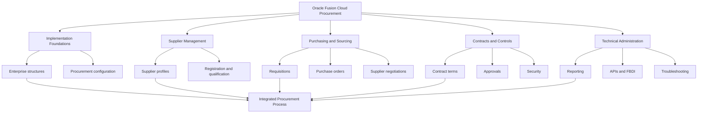
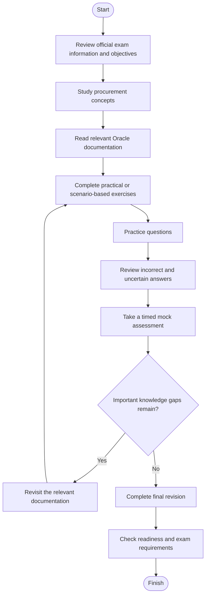
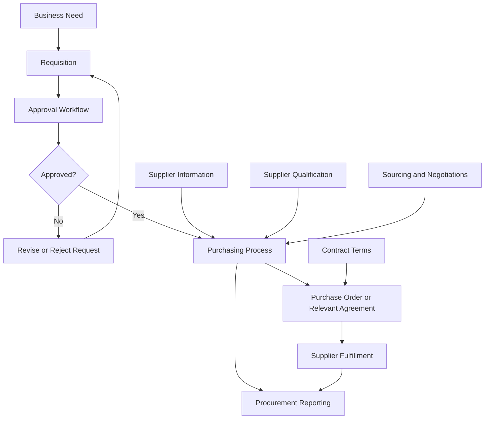
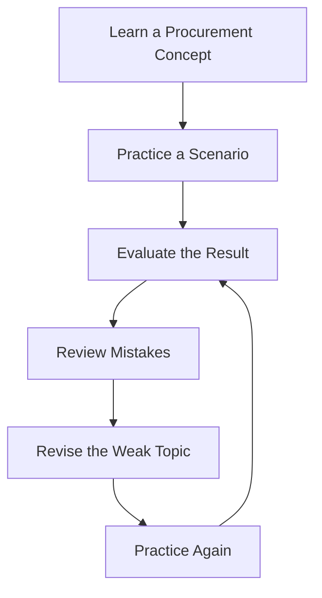
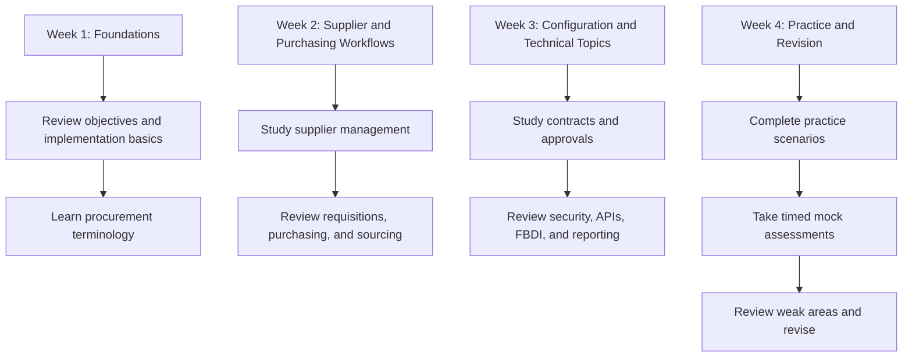

# Oracle Fusion Cloud Procurement 2026 Implementation Professional — 1Z0-1065-26

A practical, documentation-focused study guide for the **Oracle Fusion Cloud Procurement 2026 Implementation Professional (1Z0-1065-26)** certification.

This repository helps learners explore Oracle Fusion Cloud Procurement concepts, including supplier management, self-service procurement, purchasing, sourcing, supplier qualification, procurement contracts, implementation configuration, approvals, security, reporting, and integrations.

It combines a structured study roadmap, GitHub-compatible Mermaid diagrams, original practice scenarios, and links to Oracle's official documentation.

> **Exam code:** 1Z0-1065-26  
> **Certification:** Oracle Fusion Cloud Procurement 2026 Implementation Professional  
> **Provider:** Oracle  
> **Published exam duration:** 90 minutes  
> **Published question count:** 36  
> **Published passing score:** 68%  
> **Preparation approach:** Official documentation + business-process understanding + practical exercises + practice questions + revision

---

## Table of Contents

- [Overview](#overview)
- [Exam Information](#exam-information)
- [Who Should Prepare for This Certification?](#who-should-prepare-for-this-certification)
- [Understanding Oracle Fusion Cloud Procurement](#understanding-oracle-fusion-cloud-procurement)
- [Skills and Knowledge Areas](#skills-and-knowledge-areas)
- [Exam Objectives and Study Map](#exam-objectives-and-study-map)
- [Conceptual Skills Map](#conceptual-skills-map-not-official-exam-weighting)
- [Certification Preparation Flowchart](#certification-preparation-flowchart)
- [Procurement Architecture and Business Process](#procurement-architecture-and-business-process)
- [Circular Study and Revision Cycle](#circular-study-and-revision-cycle)
- [Step-by-Step Preparation Guide](#step-by-step-preparation-guide)
- [Suggested Four-Week Roadmap](#suggested-four-week-roadmap)
- [Practice Questions and Mock Tests](#practice-questions-and-mock-tests)
- [Hands-On Practice Projects](#hands-on-practice-projects)
- [Common Preparation Mistakes](#common-preparation-mistakes)
- [Career Relevance](#career-relevance)
- [Frequently Asked Questions](#frequently-asked-questions)
- [Official Learning Resources](#official-learning-resources)
- [Additional Preparation Resources](#additional-preparation-resources)
- [About CertsGate](#about-certsgate)
---

## Overview

Procurement is more than creating purchase orders. Organizations need to manage suppliers, evaluate purchasing requirements, obtain approvals, negotiate with suppliers, maintain contractual information, and keep purchasing activities aligned with business policies.

Oracle Fusion Cloud Procurement provides application capabilities for managing these processes within an enterprise cloud environment.

The 1Z0-1065-26 certification is relevant to professionals who implement, configure, administer, or support Oracle Fusion Cloud Procurement solutions.

A useful preparation strategy focuses on understanding both the application and the business processes behind it. For example, a purchasing requirement may begin with a requisition, pass through an approval process, and result in a purchase order. Supplier qualification, sourcing decisions, contractual requirements, and security settings may also influence how the process operates.

This repository provides an independent **1Z0-1065-26 study guide** to help candidates:

- Understand core procurement concepts and terminology.
- Explore supplier management and purchasing workflows.
- Learn how implementation configuration affects business processes.
- Review sourcing, supplier qualification, and contract management.
- Study security, approvals, reporting, and integration concepts.
- Practice scenario-based questions and analyze mistakes.
- Organize final revision around the current official exam objectives.

For supplementary study material, visit [CertsGate](https://certsgate.com/). Use relevant independent preparation resources alongside Oracle documentation and practical learning.

## Exam Information

The following information reflects Oracle's published certification listing.

| Item | Published information |
|---|---|
| Exam code | 1Z0-1065-26 |
| Exam name | Oracle Fusion Cloud Procurement 2026 Implementation Professional |
| Certification provider | Oracle |
| Duration | 90 minutes |
| Number of questions | 36 |
| Passing score | 68% |
| Exam delivery | Proctored online |
| Exam format | Hands-on performance-based |

Official references:

- [Oracle Certification Exam List](https://www.oracle.com/education/certification/certification-exam-list/)
- [Oracle MyLearn](https://mylearn.oracle.com/)
- [Oracle Hands-on Performance Exams FAQ](https://docs.oracle.com/en/education/customer-success/digital-learning-kit/ml-cert-faq/topics/HandsOnPerformanceExams.html)

### What does hands-on performance-based mean?

Oracle describes its hands-on performance-based certification format as including questions connected to configurations in an Oracle Cloud Applications environment. Candidates may need to review a configuration, assess how it behaves, and determine the appropriate answer based on that configuration.

This makes practical reasoning especially valuable. Instead of only memorizing what a procurement feature does, learn how its configuration relates to a business requirement and what outcome different settings may produce.

Check the current Oracle exam page for the exact delivery requirements, eligibility information, and applicable policies.

## Who Should Prepare for This Certification?

The certification may be useful for:

- Oracle Fusion Cloud Procurement implementation consultants.
- Procurement functional consultants.
- Oracle Cloud application administrators.
- Purchasing and sourcing professionals working with Oracle applications.
- Supplier management and supplier qualification specialists.
- ERP implementation and business process analysts.
- Supply chain professionals expanding their Oracle Cloud knowledge.

A background in procurement, purchasing, supply chain operations, supplier management, or enterprise applications can make the material easier to understand.

Candidates who are new to Oracle Fusion Cloud should begin with the fundamentals: application navigation, enterprise structures, roles and access, configuration tasks, and the relationship between procurement business processes.

This is a study recommendation, not a claim that every background listed above is an official prerequisite. Confirm eligibility requirements with Oracle.

## Understanding Oracle Fusion Cloud Procurement

Oracle Fusion Cloud Procurement includes capabilities for managing purchasing and supplier-related activities.

The official documentation covers several important functional areas.

### 1. Supplier management

Supplier management involves maintaining supplier information and supporting activities such as supplier registration, profile management, qualification, and collaboration.

Important questions to explore:

- How is supplier information maintained?
- What is the purpose of supplier registration?
- How does supplier qualification support procurement decisions?
- How can supplier information affect purchasing and approval workflows?

### 2. Self Service Procurement

Self Service Procurement supports employee purchasing activities, including requisition creation and the processes that move purchasing requests toward fulfillment.

Study how a business requirement becomes a requisition, how approval policies may apply, and how approved purchasing requests proceed through the configured process.

### 3. Purchasing

Purchasing covers procurement transactions such as purchase orders and supplier agreements.

Understand the relationship between purchasing documents, approval requirements, supplier information, and the organization's procurement policies.

### 4. Sourcing

Sourcing supports supplier negotiations and procurement decisions. Learn how organizations use sourcing processes to evaluate supplier responses and select suitable purchasing arrangements.

### 5. Supplier Qualification Management

Supplier qualification supports the assessment of supplier capabilities, requirements, and qualifications.

Study how qualification criteria and outcomes can help organizations determine whether a supplier meets defined business requirements.

### 6. Procurement Contracts

Procurement Contracts supports contract authoring, contract terms, approval, acceptance, and fulfillment-related activities.

Understand the purpose of contract terms and how contract management relates to the wider purchasing lifecycle.

### 7. Implementation and administration

Implementation includes configuration of enterprise structures, procurement options, approvals, security, integrations, and supporting application features.

Use the official implementation guide to learn the supported configuration processes and dependencies.

Official documentation: [Implementing Procurement — Oracle Fusion Cloud Procurement](https://docs.oracle.com/en/cloud/saas/procurement/26d/oapro/index.html).

## Skills and Knowledge Areas

The following table is an **independent study organization**, not a verified list of official exam domains or their weighting.

| Study area | Concepts to understand |
|---|---|
| Enterprise and common configuration | Enterprise structures, currencies, reference data, and implementation tasks |
| Supplier management | Supplier profiles, registrations, supplier information, and collaboration |
| Self Service Procurement | Requisitions, employee purchasing, and purchasing workflows |
| Purchasing | Purchase orders, supplier agreements, and purchasing configuration |
| Sourcing | Supplier negotiations and sourcing processes |
| Supplier Qualification Management | Qualification requirements, assessments, and outcomes |
| Procurement Contracts | Contract terms, authoring, approvals, and fulfillment |
| Approvals and security | Approval rules, roles, privileges, and access controls |
| Reporting and analytics | Procurement reporting, dashboards, and analysis |
| Integration and data movement | REST APIs, SOAP services, FBDI, and configuration migration |

Use this map to identify the documentation you need to review. For the exact examination objectives, use Oracle's current exam information and any associated objective list or learning path.

## Exam Objectives and Study Map

Oracle's official certification materials should determine your final study checklist. The areas below are drawn from the functional and implementation topics documented in Oracle Fusion Cloud Procurement.

They are useful preparation categories, but they should not be presented as official exam-domain names unless Oracle explicitly publishes them in that form.

### Area 1: Procurement foundations and configuration

Study the initial implementation process and understand how procurement configuration fits into the wider Oracle Fusion Cloud environment.

Review:

- Procurement offering and implementation planning.
- Enterprise structures.
- Common procurement configuration.
- Reference data and currencies.
- Functional Setup Manager.
- Configuration dependencies and setup migration.

**Practice task:** Describe the configuration questions an implementation team should answer before enabling a new procurement process.

### Area 2: Supplier management

Learn the purpose of supplier records and how organizations manage supplier information.

Review:

- Supplier registration.
- Supplier profiles.
- Supplier information maintenance.
- Supplier collaboration.
- Supplier qualification.
- Supplier-related security and access.

**Practice task:** Map the information a business might need to collect and review before approving a new supplier.

### Area 3: Requisitions and purchasing

Understand how employees request goods or services and how procurement teams process purchasing requirements.

Review:

- Requisition creation.
- Requisition approval.
- Purchase orders.
- Supplier agreements.
- Purchasing configuration.
- Transaction status and troubleshooting.

**Practice task:** Explain how a requisition may progress toward a purchase order and identify where configuration or approval rules could affect the process.

### Area 4: Sourcing and negotiations

Study how sourcing processes support supplier evaluation and procurement decisions.

Review the official documentation for supplier negotiations, sourcing configuration, and the relevant business process options.

**Practice task:** Outline the stages an organization may use to define a sourcing requirement, invite supplier participation, evaluate responses, and document a decision.

### Area 5: Supplier qualification

Learn how qualification requirements support supplier assessment and procurement controls.

Review the documented setup and user processes for Supplier Qualification Management.

**Practice task:** Develop a hypothetical supplier assessment checklist and explain how qualification results might influence a procurement decision.

### Area 6: Procurement contracts

Understand how procurement contracts help organizations define and manage purchasing terms.

Review:

- Contract authoring.
- Contract terms.
- Contract approvals and acceptance.
- Contract fulfillment.
- Contract-related configuration.

**Practice task:** Identify the types of business requirements that should be clarified before configuring a contract workflow.

### Area 7: Approvals, security, and integration

Learn how approval management, role-based access, and integrations support controlled procurement operations.

Review:

- Procurement approval configuration.
- Procurement roles and privileges.
- REST APIs and SOAP web services.
- File-Based Data Import (FBDI).
- Integration playbooks.
- Scheduled processes and troubleshooting.

**Practice task:** Explain how to investigate a procurement transaction that fails because of missing access, incorrect configuration, or an integration error.

## Conceptual Skills Map (Not Official Exam Weighting)

Oracle's complete exam objectives should guide your final revision. The diagram below shows relationships between major procurement learning areas. It does **not** represent official exam percentages or the number of questions assigned to each area.

Use this diagram to connect individual topics. For example, purchasing transactions may depend on supplier data, approval rules, and configuration. Understanding those relationships is more useful than studying each feature as an isolated term.

## Certification Preparation Flowchart

Follow a repeatable process that combines documentation, practical exercises, and review.

Do not treat the first completed mock test as the end of preparation. Use the results to identify topics that need additional study.

## Procurement Architecture and Business Process

The following diagram illustrates a **conceptual procurement workflow**. It is a learning aid, not an official Oracle system architecture or a guarantee that every organization uses the same process.

### Reading the workflow

- **Business need:** A department identifies a requirement for goods or services.
- **Requisition:** The requirement is recorded through the relevant purchasing process.
- **Approval workflow:** The request is evaluated against configured approval rules.
- **Purchasing:** The approved requirement proceeds through the appropriate purchasing activity.
- **Supplier and contract information:** Supplier status, sourcing decisions, and contract terms may affect the purchasing process.
- **Reporting:** Procurement transactions and related information can support operational analysis.

Real workflows depend on application configuration, procurement policies, and the business process being implemented.

### Useful process distinctions

| Concept | Main purpose |
|---|---|
| Requisition | Records a request for goods or services |
| Purchase order | Communicates purchasing requirements to a supplier |
| Supplier qualification | Assesses a supplier against defined requirements |
| Sourcing | Supports supplier negotiations and selection |
| Procurement contract | Defines and manages relevant purchasing terms |
| Approval management | Applies configured authorization rules |

Use Oracle's documentation to confirm how each concept is implemented and how the relevant objects relate to one another.

## Circular Study and Revision Cycle

Certification preparation should be iterative. Each practice attempt should help you decide what to learn or review next.

For example, if a practice question exposes confusion between supplier qualification and supplier registration, return to the relevant documentation, compare their purposes, and attempt a new scenario.

Repeat the cycle until you can explain the concepts and reason through their application without relying on memorized answer patterns.

## Step-by-Step Preparation Guide

### Step 1: Establish the official exam checklist

Start with Oracle's current certification information. Record the published exam requirements and collect any official objectives or associated learning materials.

Create a checklist with four states:

- Not studied.
- Studied but not practiced.
- Practiced with uncertainty.
- Understood and reviewed.

This helps you plan study sessions around actual gaps rather than simply counting the hours spent reading.

### Step 2: Understand the procurement lifecycle

Before memorizing configuration options, learn how procurement activities fit together.

Use a simple business example: an organization needs equipment for a department. The request may require a requisition, approval, purchasing activity, supplier coordination, and transaction reporting.

Identify where supplier data, qualification, sourcing, contract terms, and security might influence the workflow.

### Step 3: Study the implementation guide

Read the official [Implementing Procurement guide](https://docs.oracle.com/en/cloud/saas/procurement/26d/oapro/index.html).

Focus on the configuration relevant to your current study topic. Note prerequisites, setup tasks, approval configuration, security requirements, integration considerations, and common troubleshooting guidance.

### Step 4: Review user-facing workflows

Use [Using Procurement](https://docs.oracle.com/en/cloud/saas/procurement/26d/oaprc/index.html) to understand supplier information, requisitions, purchase orders, supplier agreements, supplier negotiations, and other user processes.

Comparing implementation documentation with user documentation helps you understand both how a feature is configured and how it is used.

### Step 5: Practice with scenarios

Where you have access to an authorized Oracle training environment, perform relevant exercises.

If you do not have access, create documentation-based scenarios. Write down the business requirement, relevant setup, expected outcome, and possible failure points.

Do not claim that a conceptual exercise proves hands-on experience with the application.

### Step 6: Use practice questions diagnostically

After answering a question, explain why the selected option fits the scenario.

For every incorrect or uncertain answer:

1. Identify the procurement concept being tested.
2. Find the related official documentation.
3. Explain why the original answer was incorrect or uncertain.
4. Write a short correction in your notes.
5. Attempt a different scenario involving the same concept.

Relevant third-party study material from [CertsGate](https://certsgate.com/) can be used as an additional knowledge-check resource.

### Step 7: Complete a timed assessment

Use a timed mock assessment to practice working within the published exam duration.

Review both incorrect answers and correct answers reached through guessing. A correct guess may still indicate a gap in understanding.

### Step 8: Complete final revision

Before the exam, revisit:

- The current official exam objectives.
- Procurement configuration and implementation concepts.
- Supplier management and qualification.
- Requisitions, purchasing, and sourcing.
- Procurement contracts and approvals.
- Security, reporting, and integrations.
- Your recorded mistakes and uncertain answers.

Verify the exam delivery requirements through Oracle before the scheduled appointment.

## Suggested Four-Week Roadmap

This is an independent preparation plan, not an official Oracle training schedule. Adjust it to your background, available time, and access to an Oracle training environment.

### Weekly study plan

| Week | Main focus | Suggested outcome |
|---|---|---|
| Week 1 | Exam objectives, enterprise structures, and implementation foundations | Understand the study requirements and core terminology |
| Week 2 | Supplier management, requisitions, purchasing, and sourcing | Explain key procurement workflows |
| Week 3 | Supplier qualification, contracts, approvals, security, and integrations | Understand configuration and control concepts |
| Week 4 | Scenario practice, mock tests, and final revision | Identify and address remaining knowledge gaps |

If you already work with Oracle Procurement, use your experience to identify unfamiliar or release-specific features. If you are new to the platform, spend additional time on application fundamentals before moving into complex configuration scenarios.

## Practice Questions and Mock Tests

The questions below are original educational examples. They are not official Oracle exam questions and do not reproduce protected examination content.

### Question 1: Supplier management

An organization needs to collect and maintain information about suppliers before using that information in procurement processes. Which area should the implementation team investigate first?

A. Supplier Model and supplier management functionality  
B. Unrelated inventory valuation rules  
C. Database backup scheduling only  
D. A reporting tool with no supplier data access  

**Suggested answer: A**

**Explanation:** Supplier management provides the relevant functional area for maintaining supplier information and related supplier processes. The exact configuration depends on the business requirement and Oracle's supported functionality.

Reference: [Using Procurement](https://docs.oracle.com/en/cloud/saas/procurement/26d/oaprc/index.html).

### Question 2: Requisitions and purchasing

An employee needs to request goods through an organization's configured procurement process. Which functional area is most directly relevant to the initial request?

A. Self Service Procurement  
B. Supplier qualification only  
C. Contract fulfillment reporting only  
D. External system monitoring only  

**Suggested answer: A**

**Explanation:** Self Service Procurement supports employee purchasing activities, including requisition-related workflows. The subsequent process depends on configuration and business requirements.

Reference: [Implementing Procurement](https://docs.oracle.com/en/cloud/saas/procurement/26d/oapro/index.html).

### Question 3: Supplier evaluation

A company wants to assess whether a supplier meets defined requirements before using that supplier for a particular business purpose. Which area should be investigated?

A. Supplier Qualification Management  
B. Dashboard formatting only  
C. Currency display preferences only  
D. Purchase order print layout only  

**Suggested answer: A**

**Explanation:** Supplier Qualification Management supports supplier assessment against defined qualification requirements. Consult the implementation and user documentation for the supported setup and evaluation processes.

### Question 4: Integration troubleshooting

An external application needs to exchange supported procurement data with Oracle Fusion Cloud Procurement. Which documentation is the most appropriate starting point for identifying supported API resources?

A. Oracle Fusion Cloud Procurement REST API documentation  
B. An unrelated product's user guide  
C. A generic study schedule  
D. An unsupported database query copied from an unknown source  

**Suggested answer: A**

**Explanation:** Oracle's REST API documentation describes available resources, supported operations, and integration guidance. Always check access requirements and the relevant API specification.

Reference: [Oracle Procurement APIs, Business Objects, and Schema](https://docs.oracle.com/en/cloud/saas/procurement/26d/api.html).

### How to use practice questions effectively

A useful practice session should include:

- Questions aligned with the current objectives.
- Clear explanations of the underlying concept.
- Scenario-based reasoning.
- Review of incorrect and uncertain responses.
- Mapping mistakes to the appropriate documentation.
- Follow-up practice to confirm that the issue has been resolved.

Do not assume that a third-party question is official, current, or identical to a question used in the certification examination.

## Hands-On Practice Projects

Use an authorized Oracle training environment for configuration activities. If you do not have access to one, work through the scenarios using official documentation and clearly record that the exercises are conceptual.

### Project 1: Map a requisition-to-purchasing workflow

**Goal:** Understand the relationship between a purchasing requirement and its processing stages.

Tasks:

1. Define a hypothetical request for goods or services.
2. Identify the information needed to describe the requirement.
3. Map the relevant requisition and approval stages.
4. Explain how the request may progress into purchasing.
5. Identify configuration or policy questions that must be resolved.
6. Document possible reasons a request could be delayed or rejected.

**Expected learning:** A process-oriented understanding of requisitions, approvals, and purchasing.

### Project 2: Develop a supplier qualification scenario

**Goal:** Understand how supplier assessment supports procurement decisions.

Tasks:

1. Create a hypothetical supplier evaluation scenario.
2. List the business requirements that must be assessed.
3. Review the relevant Oracle Supplier Qualification Management documentation.
4. Identify the documented setup and process considerations.
5. Describe how an assessment result could inform a business decision.
6. Record any assumptions that need confirmation.

**Expected learning:** A better understanding of supplier qualification and its role in procurement controls.

### Project 3: Review a sourcing scenario

**Goal:** Understand how sourcing supports supplier selection.

Tasks:

1. Define a hypothetical requirement for a product or service.
2. Identify the information needed to evaluate supplier responses.
3. Review Oracle's sourcing documentation.
4. Map the relevant negotiation stages.
5. Identify factors that may affect the procurement decision.
6. Explain how the outcome should be documented.

**Expected learning:** Familiarity with sourcing processes and supplier negotiation concepts.

### Project 4: Trace an integration requirement

**Goal:** Learn how to investigate procurement integrations.

Tasks:

1. Describe a hypothetical need to exchange procurement data with another application.
2. Identify the business object or process involved.
3. Review Oracle's REST API documentation and, where relevant, its SOAP and FBDI guides.
4. Check the supported resource, operations, permissions, and input requirements.
5. Record possible error scenarios and troubleshooting steps.
6. Explain how you would validate the result in an authorized environment.

**Expected learning:** A methodical approach to Oracle Procurement integration research.

## Common Preparation Mistakes

### Memorizing answers instead of understanding processes

Knowing an answer key does not demonstrate that you understand procurement configuration.

**Better approach:** Explain why the selected solution fits the business requirement and why other approaches may not.

### Ignoring official documentation

Third-party study material may not fully reflect the current release.

**Better approach:** Use Oracle's implementation and user guides as the technical authority.

### Studying supplier management and purchasing separately

Supplier information, qualification, purchasing configuration, and approvals may interact.

**Better approach:** Trace complete business scenarios and identify where each functional area contributes.

### Skipping configuration concepts

Implementation questions may require understanding how settings affect application behavior.

**Better approach:** Review the relevant setup documentation and use an authorized environment when available.

### Taking mock tests without reviewing mistakes

A practice score alone does not show which concepts remain unclear.

**Better approach:** Maintain a mistake log and map each issue to the relevant study area.

### Treating old material as current

Oracle Cloud applications receive updates, so older guides may describe different functionality.

**Better approach:** Check the documentation release and confirm that your preparation matches the current certification.

## Career Relevance

Oracle Fusion Cloud Procurement knowledge may be relevant to work involving:

- Oracle Procurement implementation.
- Procurement functional consulting.
- Supplier management.
- Purchasing and sourcing processes.
- Supplier qualification and contract administration.
- ERP and supply chain application support.
- Procurement process analysis and application administration.

The certification can help demonstrate knowledge of the relevant Oracle product area. Its professional value depends on practical skills, implementation experience, job requirements, and other qualifications. It does not guarantee employment or career advancement.

## Frequently Asked Questions

### What is the 1Z0-1065-26 certification?

It is the Oracle Fusion Cloud Procurement 2026 Implementation Professional certification examination.

### How long is the exam?

Oracle's published certification listing specifies 90 minutes. Confirm the latest requirements before scheduling.

### How many questions are included?

The published listing specifies 36 questions.

### What is the passing score?

Oracle's published listing specifies a passing score of 68%.

### Is the exam hands-on?

Oracle lists 1Z0-1065-26 among its hands-on performance-based exams. Review Oracle's current exam information for the latest format and delivery details.

### What should I study for 1Z0-1065-26?

Start with Oracle's official exam information and any published objectives or associated learning materials. Relevant documentation areas include procurement implementation, supplier management, self-service procurement, purchasing, sourcing, supplier qualification, contracts, approvals, security, reporting, and integration.

The precise final checklist should be based on the current official objectives rather than this independent study map alone.

### Do I need Oracle Procurement work experience?

Experience with procurement processes or Oracle Cloud applications can help, but verify any formal eligibility requirements through Oracle. Do not assume that this study guide defines official prerequisites.

### Are CertsGate practice questions official Oracle questions?

CertsGate is presented here as an independent preparation resource. Do not assume that third-party questions are official Oracle examination questions or identical to live exam content.

### How can I assess my readiness?

You should be able to explain core concepts, reason through business scenarios, understand configuration dependencies, and correct mistakes using official documentation. Use timed practice to identify remaining gaps, not as a guarantee of the result.

## Official Learning Resources

The following Oracle resources provide the technical foundation for preparation.

| Resource | How to use it |
|---|---|
| [Oracle MyLearn](https://mylearn.oracle.com/) | Find official learning content and certification information |
| [Oracle Certification Exam List](https://www.oracle.com/education/certification/certification-exam-list/) | Verify published exam requirements |
| [Implementing Procurement](https://docs.oracle.com/en/cloud/saas/procurement/26d/oapro/index.html) | Study implementation configuration and setup |
| [Using Procurement](https://docs.oracle.com/en/cloud/saas/procurement/26d/oaprc/index.html) | Review supplier, requisition, purchasing, and sourcing processes |
| [Oracle Procurement APIs, Business Objects, and Schema](https://docs.oracle.com/en/cloud/saas/procurement/26d/api.html) | Explore REST APIs, SOAP services, business objects, and related technical references |
| [Scheduled Processes for Procurement](https://docs.oracle.com/en/cloud/saas/procurement/26d/faspp/index.html) | Review scheduled process documentation |
| [Creating and Administering Analytics and Reports for Procurement](https://docs.oracle.com/en/cloud/saas/procurement/26d/fapaa/index.html) | Study procurement analytics and reporting |
| [Integration Playbooks for Procurement](https://docs.oracle.com/en/cloud/saas/procurement/26d/fainp/index.html) | Explore documented procurement integration patterns |
| [Security Reference for Procurement](https://docs.oracle.com/en/cloud/saas/procurement/26d/oapcm/index.html) | Review procurement roles and privileges |
| [File-Based Data Import and Integration Documentation](https://docs.oracle.com/en/cloud/saas/procurement/26d/books.html) | Locate procurement data import and integration guides |

Oracle documentation paths can change between releases. If a link becomes unavailable, search the official Oracle Help Center for the current Procurement documentation.

## Additional Preparation Resources

Official Oracle documentation should remain the foundation of your study plan. Independent learning materials can provide additional explanations, practice opportunities, and revision support.

Visit [CertsGate](https://certsgate.com/) to explore available IT certification preparation resources.

When evaluating any additional resource:

- Check whether it covers the current certification release.
- Compare its topics with the official objectives.
- Prefer questions that explain the reasoning behind an answer.
- Verify technical claims against Oracle documentation.
- Avoid relying on purported leaked questions or unsupported answer keys.
- Use practice results to identify topics that need further study.

A useful preparation sequence is:

**Official Objectives → Documentation → Business-Process Understanding → Practical Exercises → Practice Questions → Mistake Analysis → Readiness Review**

## About CertsGate

[CertsGate](https://certsgate.com/) is an independent IT certification preparation resource.

Learners preparing for Oracle Fusion Cloud Procurement 2026 may use relevant CertsGate materials as a supplement to official Oracle learning content, documentation, and practical exercises.

Use supplementary questions to test understanding, identify weak areas, and guide further revision. Keep Oracle's official resources as the authority for certification requirements and product behavior.
